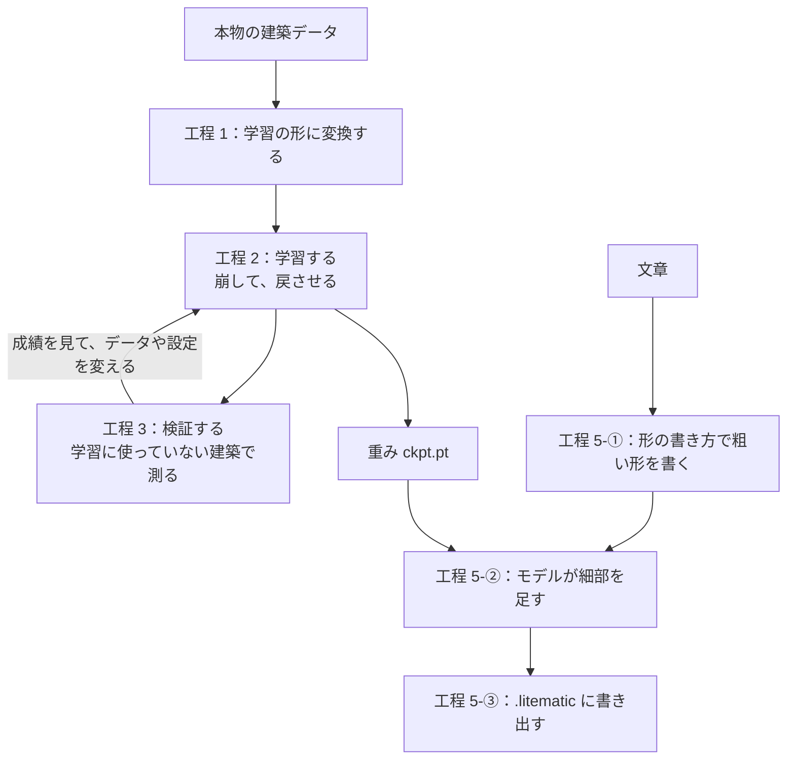

# LizArc 学習の工程とプログラム

2026-11-19 の時点の、学習の進め方と、プログラムの中身をまとめたものです。

- なぜこの方法にしたか、実験の結果は、「LizArc 学習方法の設計」にあります。
- 学習を手伝うチームメンバーの準備の手順は、「LizArc チームメンバーへの説明」にあります。
- プログラムの本体は `D:\Claudcode\Liz_ARC` にあります（保存の番号は `f88c40b`）。ここには、流れと要点だけを書きます。
- 学習の本体（`train\lizarc_train.py`）の全文は、[[LizArc code]] に写してあります。

## 1. 全体の流れ



| 工程 | すること | 言語 |
|---|---|---|
| 1. データの準備 | 建築を 32×32×32 の区画にし、ブロックに番号を振る。回転や反転の表、素材と形の表を作る | Python と Rust |
| 2. 学習 | 区画を崩して、モデルに元へ戻させる。外れた分だけ重みを直す | Python（PyTorch） |
| 3. 検証 | 学習に使っていない建築で、当たった割合を測る | Python（PyTorch） |
| 4. 学習の回し方 | 始める、止める、続ける、順番に回す、GPU を使いすぎないようにする | PowerShell |
| 5. 作るとき | 文章 → 粗い形 → 細部を足す → 設計図 | Rust と Python |

## 2. 言葉

| 言葉 | 意味 |
|---|---|
| 区画 | 32×32×32 ブロックの箱。モデルは、この大きさずつ見る |
| 状態 | ブロックの種類に、向きなどを足したもの。例：`minecraft:oak_stairs[facing=east,half=bottom]` |
| 語彙 | 学習で使う状態の一覧。1 行に 1 つ。行の番号が、そのブロックの番号になる |
| ふつうのブロック | 1 ブロックをまるごと占めるもの（石、板、ガラスなど） |
| 細部 | ブロックの一部だけを占めるもの（階段、ハーフ、塀、柵、板ガラス、ドア、トラップドア） |
| 飾り | 薄いものや植物（たいまつ、カーペット、花、看板など） |
| 崩す | 本物の区画から細部と飾りを取り去って、粗い形にすること |
| 素材と形 | 状態を 2 つに分けたもの。例：クォーツの階段 → 素材「クォーツ」＋形「階段・東向き・下付き」 |
| 歩 | 重みを 1 回直すこと。1 歩で 16 個の区画を見る |
| 基準 | 「崩したまま何もしない」ときの成績。モデルは、これを上回らないと意味がない |

## 3. 工程 1：データの準備

### 使っているデータ

| 名前 | 中身 | 置き場所 | 条件 |
|---|---|---|---|
| Dream-Cubed（`ds_v0`） | プロの建築家 1 人の 6 マップ。色と木の種類はつぶれている | `data\lizarc\ds_v0` | 非商用の研究のみ |
| 3D-Craft（`ds_c3d`） | 181 人が建てた家、約 2,500 軒。色と木の種類が残っている | `data\lizarc\ds_c3d` | 条件がはっきり書かれていない。研究の試行のみ |

### 変換ですること

1. **建築を読む。** 3D-Craft は 1 軒ごとの配列、Dream-Cubed は 32×32×32 の区画の束です。
2. **状態を整理する。** となりから決まる性質（柵のつながり、水没など）を外します。3D-Craft では、階段の角の形も外します。
3. **語彙を決める。** よく出る状態に番号を振ります。番号 0 は空気、番号 1 は「その他」（まれな状態の受け皿）です。
4. **区画にする。** 32×32×32 に収まる家は、位置をずらして 4 通り置きます。大きい建築は、16 ずつずらして切ります。
5. **学習用と検証用に分ける。** 分け方は、次の表のとおりです。
6. **表を作る。** 下の「変換でできる表」のとおりです。

| データ | 学習用 | 検証 ①（同じ出どころの、使っていない部分） | 検証 ②（学習に出てこない出どころ） |
|---|---|---|---|
| Dream-Cubed | 5 マップの区画 110,908 個 | 同じ 5 マップから取り置いた区域（128×128 の区域を 1 割） | 6 つ目のマップ（marethea） |
| 3D-Craft | 1,943 軒（165 人）、区画 7,376 個 | 同じ人の、取り置いた家 209 軒 | 取り置いた 18 人の家 349 軒 |

### 変換でできる表

| ファイル | 中身 | 何に使うか |
|---|---|---|
| `vocab.txt` | 語彙 | 番号とブロックの対応 |
| `train_tokens.npy`、`val_tokens.npy` | 区画の束。（区画の数, 32, 32, 32）で、並びは東西・上下・南北 | 学習と検証 |
| `kind.npy` | 各番号が、空気・ふつう・細部・飾りのどれか | 成績の集計 |
| `simplify.npy` | 各番号を「粗い形」にしたときの番号。階段 → 素材のブロック、柵や飾り → 空気、向きつきのブロック → 代表の向き | 崩すとき |
| `rot_cw.txt`、`mirror_x.txt` | 右に 90 度回したとき、東西に裏返したときに、番号がどう変わるか | 見本を増やすとき |
| `v1\tables.npz` | 素材と形に分ける表、戻す表、細部を消す確率、学習と検証の分け方 | 学習 |

回転と反転の表は、Rust で作ります。階段を裏返すと「左の角」と「右の角」が入れ替わる、といった決まりがあり、テストで確かめています。

### 動かし方

3D-Craft（ダウンロードから照らし合わせまで、まとめて）：

```powershell
pwsh tools\c3d_setup.ps1
```

Dream-Cubed（順に）：

```powershell
pwsh tools\download_dreamcubed_human.ps1
```

```powershell
.venv\Scripts\python.exe -I -X utf8 tools\dc_convert_all.py
```

```powershell
.venv\Scripts\python.exe -I -X utf8 tools\build_dataset.py stats
```

```powershell
.venv\Scripts\python.exe -I -X utf8 tools\build_dataset.py build --min-count 1000 --min-detail 160 --val-map marethea
```

```powershell
.venv\Scripts\python.exe -I -X utf8 tools\build_v1_tables.py
```

- `build` の数字は、今の `ds_v0` を作ったときの指定です（語彙に入れるのは 1,000 回以上出る状態、区画は細部が 160 個以上あるものだけ、検証に回すマップは marethea）。`ds_v0\meta.json` に記録が残っています。
- 回転と反転の表は、3D-Craft と同じく `lizarc rot-table` と `lizarc mirror-table` で作ります。
- **Dream-Cubed の手順は、作ったときの順番を書いたものです。最初から通してやり直すことは、試していません。** 3D-Craft の手順は、作り直して同じデータになることを確かめました。

## 4. 工程 2：学習

プログラムは `train\lizarc_train.py` です。

### 1 歩の中身

| 順 | すること | 中身 |
|---|---|---|
| 1 | 区画を選ぶ | 学習用の区画から、16 個を無作為に選ぶ |
| 2 | 見本を増やす | 右に 0〜3 回まわす。半分の確率で、東西に裏返す。向きの状態も、表で直す |
| 3 | 崩す | 階段・ハーフ・塀を、素材のブロックに直す。そのうち一部は消す（階段 10%、ハーフ 50%、塀 70%）。柵・板ガラス・ドア・飾りは消す。5 回に 1 回は、何も消さずに素材へ直すだけにする |
| 4 | 隠す | 本物の区画の一部を「隠してある」の印に替える。半分の見本は全部隠す。残りは 0〜100% のあいだで隠す |
| 5 | 当てさせる | モデルに、崩した区画と、隠した区画を見せる。隠した所の「形」と「素材」を当てさせる |
| 6 | 答え合わせ | 本物と 1 個ずつ比べる。ブロックのまわり 2 ブロックまでを中心に見る。遠くの空気は、少しだけ（重み 0.1 倍）見る |
| 7 | 重みを直す | 外れた分だけ、重みを少し動かす |

「崩した区画」は、作るときにモデルが受け取る「粗い形」の代わりです。学習のときから、作るときと同じ姿を見せておきます。

下の 3 つのプログラムは、`train\lizarc_train.py` から要点だけを抜き出したものです。読みやすいように、注釈を書き足し、細かい場合分けを省いています。

### 崩すところ（プログラム）

```python
def degrade(target, tables, strength=None, gen=None):
    simple = tables["simplify"][target]          # 細部は素材のブロックに、飾りは空気に
    p = tables["p_air"][target]                  # その細部を消す確率
    if strength is not None:
        p = p * strength.view(-1, 1, 1, 1)       # 5 回に 1 回は 0（消さない）
    drop = torch.rand(target.shape, device=target.device, generator=gen) < p
    return torch.where(drop, torch.zeros_like(simple), simple)
```

### 隠して、答え合わせをするところ（プログラム）

```python
# 隠す割合：半分の見本はぜんぶ隠す。残りは 0〜100% のあいだ。
ratio = torch.cos(torch.rand(b, device=device) * math.pi / 2)
ratio = torch.where(torch.rand(b, device=device) < 0.5, torch.ones_like(ratio), ratio)
mask = torch.rand(target.shape, device=device) < ratio.view(-1, 1, 1, 1)
inp = torch.where(mask, torch.full_like(target, model.mask_id), target)

# 形の答え合わせ ＋ 素材の答え合わせ（空気や飾りには、素材の答え合わせをしない）
ce = (F.cross_entropy(ls.float(), t_shp, reduction="none")
      + F.cross_entropy(lm.float(), t_mat, reduction="none") * needs_mat)
loss = ce[:n_near].mean()                        # ブロックのまわり
loss = loss + 0.1 * ce[n_near:].mean()           # 遠くの空気は、少しだけ
```

点数は使いません。本物と合っているかどうかだけで、重みを直します。

### モデルの形

名前は `Detailer` です。立体のまま細かさを変えながら見る形（3D U-Net）で、重みは約 4,050 万個です。

| 段 | 細かさ | 太さ（チャンネル） | 中身 |
|---|---|---|---|
| 入り口 | 32×32×32 | 96 | 崩した区画と隠した区画を、それぞれ「素材の数字の列」＋「形の数字の列」に直して重ねる |
| 下り 1 | 32×32×32 | 96 | たたみこみの組 ×2 |
| 下り 2 | 16×16×16 | 192 | たたみこみの組 ×2 |
| 底 | 8×8×8 | 384 | （たたみこみの組 ＋ 区画全体を見渡す部分）×3 |
| 上り 2 | 16×16×16 | 192 | 下りの同じ段とつないで、たたみこみの組 ×2 |
| 上り 1 | 32×32×32 | 96 | 同じく ×2 |
| 出口 | 32×32×32 | — | 1 ブロックごとに、「形」の答えと「素材」の答えを別々に出す |

答えは、形と素材のいちばん自信のあるものを、表で 1 つの状態に組み合わせます。

```python
def decode(ls, lm, tables):
    return tables["compose"][lm.argmax(1), ls.argmax(1)]
```

素材と形を分けているのは、「ここは階段」という決まりを、素材が違う建築でも使い回せるようにするためです。

### 設定

| 設定 | 値 |
|---|---|
| 1 歩で見る区画 | 16 個 |
| 重みを動かす大きさ（学習率） | 0.0003。最初の 500 歩は、少しずつ上げる。そのあとは一定 |
| 重みの直し方 | AdamW（重みを小さく保つ強さ 0.01） |
| 一度に動かす大きさの上限 | 1.0 |
| 計算の細かさ | 16 ビット（bfloat16）を混ぜて、速くする |
| 1 歩で答え合わせをする場所の上限 | ブロックのまわり 100,000 か所、遠くの空気 8,000 か所 |
| 自動保存 | 10 分ごと |

### 動かし方

```powershell
.venv\Scripts\python.exe -I -X utf8 train\lizarc_train.py --run 名前 --data ds_c3d --max-steps 6000 --eval-every 1000
```

| 指定 | 意味 |
|---|---|
| `--run` | 学習の名前。`runs\名前` に記録と重みが入る |
| `--data` | 使うデータ。`ds_v0`（Dream-Cubed）か `ds_c3d`（3D-Craft） |
| `--max-steps`、`--max-minutes` | 何歩で、または何分で止めるか |
| `--eval-every` | 何歩ごとに検証するか |
| `--train-fraction` | 学習データのうち、使う割合。データの量を変えて比べるときに使う |
| `--maps` | 学習に使うマップ（または建てた人）の名前。種類を変えて比べるときに使う |
| `--seed` | 乱数の種。同じ条件でやり直すときに変える |

同じ名前でもう一度起動すると、保存した所から続きます。そのとき、設定は最初に決めたものを引き継ぎます。

## 5. 工程 3：検証

学習の途中で、学習に使っていない区画を崩してモデルに戻させ、本物と比べます。崩し方は毎回同じにして、前の回と比べられるようにしています。

### 測るもの

| 名前 | 意味 |
|---|---|
| 当たり | ブロックのある所のうち、本物とぴったり同じ状態を出した割合 |
| 基準 | 崩したまま何もしないときの当たり |
| 細部を戻せた割合 | 本物が細部の所のうち、形も素材も合った割合 |
| 形まで合った割合 | 同じく、形（種類と向き）が合った割合 |
| 置いた細部のうち合っていた割合 | モデルが細部を置いた所のうち、本物と合っていた割合 |
| 細部の量 | モデルが置いた細部の数 ÷ 本物の細部の数 |

### 2 つの検証

| 検証 | 中身 | 何が分かるか |
|---|---|---|
| ① | 学習と同じ出どころの、使っていない部分 | 暗記ではなく、決まりを学べているか |
| ② | 学習に出てこない出どころ | 見たことのない作風にも通じるか |

### 2 つの当て方

| 当て方 | 中身 | 今の成績 |
|---|---|---|
| 一度に全部当てる | 全部を隠した状態から、1 回で答えを出す | こちらのほうが良い |
| 数回に分けて埋める | 自信のある所から 8 回に分けて埋める | 細部の量は本物に近いが、置く場所を外しやすい |

学習のあとには、`train\diagnose.py` で「どこで外しているか」も調べます。階段・ハーフ・塀・そのほかの細部ごとに当たった割合と、本物が細部の所に代わりに何を置いたかを出します。

```powershell
.venv\Scripts\python.exe -I -X utf8 train\diagnose.py --run 名前 --chunks 2048 --out runs\名前\diagnose.txt
```

## 6. 工程 4：学習の回し方

### 学習の記録が入る場所

`runs\学習の名前\` に、次のファイルができます。

| ファイル | 中身 |
|---|---|
| `log.jsonl` | 100 歩ごとの誤差と速さ、検証のたびの成績 |
| `ckpt.pt` | 重みと、続きから始めるための情報（約 490MB） |
| `STATE` | 状態。`running`（学習中）、`paused`（一時停止中）、`finished`（終了） |
| `PAUSE` | このファイルを作ると、その時点を保存して終わる |
| `diagnose.txt` | 外し方の調べの結果 |

### 道具

| 道具 | すること |
|---|---|
| `学習の様子.bat` | 進み具合と成績を表示する |
| `学習を一時停止.bat` | その時点を保存して、学習を終わる。GPU が空く。順番待ちの次の学習も始まらなくなる |
| `学習を再開.bat` | 保存した所から続ける。順番待ちも動き出す |
| `tools\train_start.ps1` | 学習を始める、または続ける（bat の中身） |
| `tools\train_queue.ps1` | いくつかの学習を、順番に回す。1 つ終わるたびに、外し方の調べも回す。一覧は `runs\queue.json` に書く |
| `runs\GPU_LIMIT` | GPU の使い方を決めるファイル。`55` と書くと、学習の取り分を 55% に固定する（このパソコンは今これ）。`total 50` と書くと、GPU 全体の使用率が 50% くらいになるように、学習が自分の取り分を自動で加減する（手伝う人のパソコンは、準備のときにこれになる）。学習中に書き換えても、10 秒ほどで効く |
| `tools\gpu_check.py` | GPU の名前とメモリを調べて、今の設定で学習できるかを知らせる。学習の始めにも同じことを調べて、記録に残す |

GPU の使いすぎを抑える仕組みは、1 歩ごとに短い休みを入れるものです。歩数で止める学習なら、遅くなるだけで、結果は変わりません。

## 7. 工程 5：作るとき

| 段 | すること | 道具 |
|---|---|---|
| ① 形づくり | 文章から、「形の書き方」で粗い形を書く。ふつうのブロックだけを使う | 書くのは Claude Code。ブロックに直すのは `lizarc shape`（Rust、`src\shape.rs`） |
| ② 仕上げ | 粗い形を、学習のときの「崩した区画」と同じ姿にして、モデルに細部を足させる | `train\detail.py` |
| ③ 書き出し | 粗い形と仕上げ後を並べて、`.litematic` にする。柵・板ガラス・塀のつながりと、階段の角を計算し直す | `lizarc assemble`（Rust、`src\connect.rs`） |

### 形の書き方

1 行に 1 つの命令を書きます。座標は、x が東、y が上、z が南です。範囲は両端を含みます。`#` から後ろは注釈です。

| 命令 | 意味 |
|---|---|
| `size 幅 高さ 奥行き` | 全体の大きさ |
| `fill x1 y1 z1 x2 y2 z2 ブロック` | 箱を埋める |
| `walls …` | 箱の 4 つの壁だけ |
| `shell …` | 箱の 6 つの面（中は空） |
| `frame …` | 箱の 12 本の辺だけ |
| `clear x1 y1 z1 x2 y2 z2` | 空気にする（窓や戸口の穴） |
| `gable x1 y z1 x2 z2 向き ブロック` | 切妻屋根。向きは `x` か `z` で、棟（屋根のてっぺんの線）の向き |
| `hip x1 y z1 x2 z2 ブロック` | 寄棟屋根 |
| `tube cx cz 半径 y1 y2 ブロック` | 円い筒（中は空） |
| `disc cx cz 半径 y1 y2 ブロック` | 円い柱 |
| `cone cx cz 半径 y ブロック` | 円すいの屋根 |

例（`shapes\house1.shape.txt` の一部）：

```text
size 19 15 15
fill  2 0 2 16 0 12 cobblestone        # 土台
walls 2 2 2 16 5 12 birch_planks       # 壁
clear 9 2 12 9 3 12                    # 戸口
gable 2 6 1 16 13 x bricks             # 屋根
```

### 動かし方

```powershell
cargo run --release --bin lizarc -- shape shapes\house1.shape.txt out\house1.vox out\house1.vocab.txt
```

```powershell
.venv\Scripts\python.exe -I -X utf8 train\detail.py --run c3d_all --vox out\house1.vox --vocab out\house1.vocab.txt --out out\house1_detail
```

```powershell
cargo run --release --bin lizarc -- assemble out\lizarc_house1.litematic --rename tools\names_for_export.txt out\house1.vox out\house1.vocab.txt out\house1_detail.vox out\house1_detail.vocab.txt
```

ゲームを開かずに形を確かめるときは、高さごとの文字の地図を出します。

```powershell
.venv\Scripts\python.exe -I -X utf8 tools\show_vox.py out\house1.vox out\house1.vocab.txt
```

## 8. プログラムの一覧

### Rust（`src\`）

| ファイル | 役目 |
|---|---|
| `block.rs` | ブロックの状態の読み書き（名前と性質） |
| `nbt.rs` | マイクラのデータ形式（NBT）の読み書き |
| `litematic.rs` | `.litematic` の読み書き |
| `transform.rs` | 状態の回転と左右反転、区画への切り分け |
| `vox.rs` | 中間形式（`.vox` と `.vocab.txt`）の読み書き。Python との受け渡しに使う |
| `shape.rs` | 形の書き方を、ブロックの並びに直す |
| `connect.rs` | となりから決まる状態（柵・板ガラス・塀のつながり、階段の角）を計算し直す |
| `bin\lizarc.rs` | 命令の入り口。`testboard`、`info`、`roundtrip`、`vox2lit`、`rot-table`、`mirror-table`、`shape`、`assemble` |

テストは 22 個あります。`cargo test --release` で回せます。

### 学習（`train\`）

| ファイル | 役目 |
|---|---|
| `lizarc_train.py` | 学習の本体（今の版）。モデル、崩し方、検証、保存、一時停止 |
| `diagnose.py` | どこで外しているかを調べる |
| `detail.py` | 学習したモデルで、粗い形に細部を足す |
| `lizarc_train_v0.py`、`diagnose_v0.py`、`debug_sampling.py` | 最初の版（v0）と、その調べ。記録として残している |

### データと道具（`tools\`）

| ファイル | 役目 |
|---|---|
| `c3d_setup.ps1` | 3D-Craft を落として、変換し、照らし合わせる（まとめ役） |
| `c3d_build.py` | 3D-Craft を学習の形に変換する |
| `c3d_stats.py` | 3D-Craft の中身を数える |
| `download_dreamcubed_human.ps1` | Dream-Cubed の人の建築データ（元の区画、約 1.5GB）を落とす |
| `dc_convert_all.py` | Dream-Cubed の区画を、LizArc の形に直す |
| `build_dataset.py` | Dream-Cubed の語彙を決め、学習用と検証用に分けて書き出す |
| `build_v1_tables.py` | 素材と形に分ける表を作る |
| `dc_to_vox.py` | Dream-Cubed の区画を、中間形式に直す（見本を設計図にするとき） |
| `dc_check_axes.py`、`check_rotation.py` | 配列の向き（東西・南北）と、回転の正しさを、データで確かめる |
| `inspect_npz.py`、`peek_pickle.py` | 落としたデータを、中のプログラムを動かさずにのぞく |
| `verify_testboard.py` | 検査盤の設計図を、Rust とは別の手順で読み直して確かめる |
| `show_vox.py` | 中間形式を、高さごとの文字の地図で表示する |
| `train_start.ps1`、`train_pause.ps1`、`train_status.ps1`、`train_queue.ps1` | 学習を始める、止める、様子を見る、順番に回す |
| `names_for_export.txt` | 設計図に書き出すときに直す、古いブロックの名前の表 |

## 9. これまでの学習

| 名前 | データ | 中身 | 結果 |
|---|---|---|---|
| `v0` | Dream-Cubed | 最初の版。2×2×2 の多数決で粗くしてから戻す。3 時間 | 細部はほぼ当たらず（1%）。暗記と、崩しすぎが原因 |
| `v1` | Dream-Cubed | 今の方式。2 時間、21,847 歩 | 同じマップの別の場所では、細部の 67% を戻せた。別のマップでは 20% |
| `g3_map1`、`g3_map2`、`g3_half`、`g3_quarter` | Dream-Cubed | マップの数と、区画の量を変えて比べる。各 8,000 歩 | 量を 4 倍にしても変わらない。マップを 1 → 2 → 5 と増やすと、別のマップの細部が 8% → 10% → 20% に上がった |
| `c3d_100`、`c3d_all`、`c3d_400`、`c3d_1600` | 3D-Craft | 家の数を変えて比べる。各 6,000 歩 | 回している途中（2026-11-19）。結果は「学習方法の設計」に書く |

## 10. 今の弱点と、まだ無いもの

- **見たことのない作風には、まだ弱いです。** 学習に出てこないマップでは、細部を 2 割しか戻せません。建築の種類を増やすと上がるかを、今測っています。
- **細部を消す確率（階段 10%、ハーフ 50%、塀 70%）は、見積もりです。** 実際の粗い形と合っているかは、確かめていません。
- **作るときの粗い形が、学習のときの「崩した区画」と似ているかは、まだ確かめていません。** 似ていないと、細部をうまく足せません。
- **32×32×32 より大きい建物に細部を足す処理は、書いてありますが、まだ動かしていません。**
- **画像からの入口（3D 化 AI の出力をブロックにする）は、まだ作っていません。**
- **文章を直接モデルに入れる仕組みは、ありません。** 文章は、Claude Code が形の書き方に直します。
- **できた建築は、まだゲームで見て確かめていません。**
